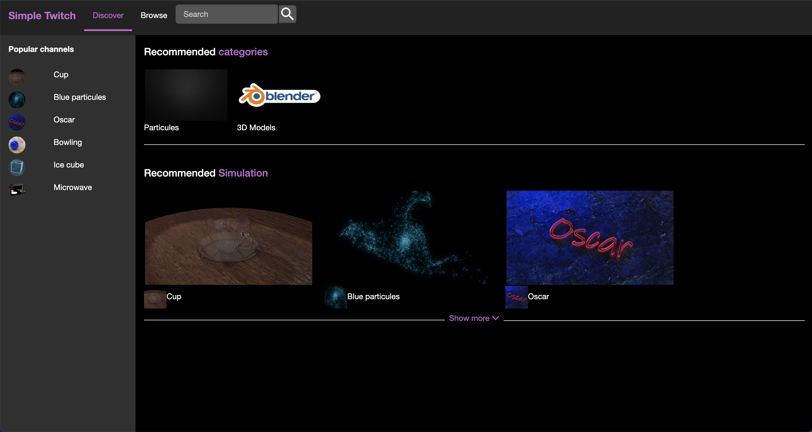
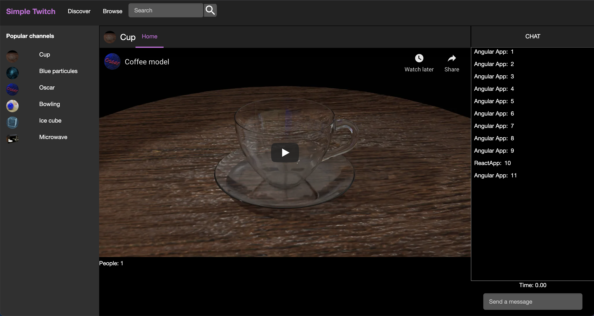

# SimpleTwitch (In development)

**Website (In development)**: https://simple-twitch.codename-project.com/

**Description:** Channel-based platform for showing videos and 3D models.

**Features**:
* Discover: List of recommendations (categories and channels)
* Browse: List of categories and channels
* Channel:
    * Content: YouTube video or 3D model
    * Chat: Comments
* Backend:
    * Github: https://github.com/oscarjcg/simple-twitch-backend-laravel

**Development environment**:
* **Operating system:** Windows 11 64-bit
* **Angular:** 22.2
* **Angular CLI:** 22.2
* **Node:** 22 (Docker image `node:22`)
* **Bootstrap:** 3.4.1

**Docker**:
* Run docker compose and it will install packages and start npm start (http://localhost:4201)
    * `docker compose up`
* Delete container (not image and node_modules)
    * `docker compose down`
* Production build (output in `dist/simple-twitch`)
    * `docker compose run --rm st-angular-build`
* Deploy to Firebase Hosting
    * `firebase deploy`
